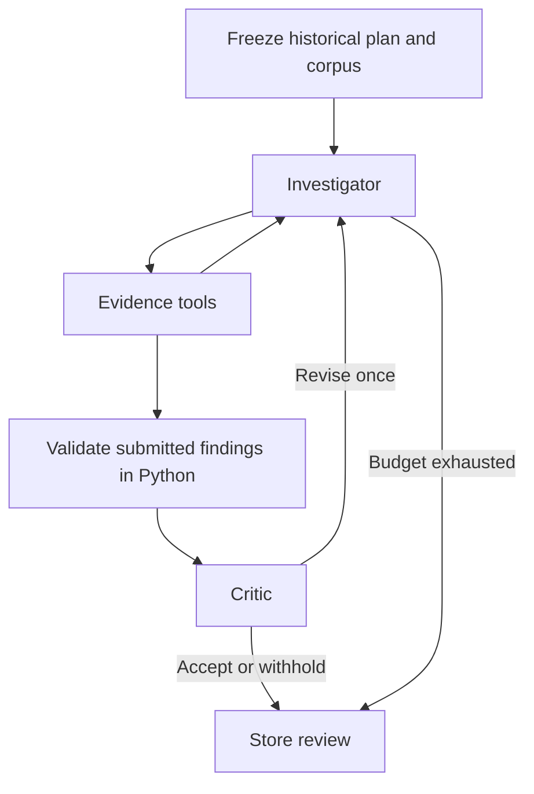

# LangGraph risk investigation

Nabu now has a bounded, checkpointed **gap investigation** workflow. The initial
implementation uses Anthropic directly for live model calls; Bedrock, Foundry and
LangSmith hosting are not required. Other model adapters can be added behind the
same graph interface.



The investigator chooses searches and inspections within its stage. Python
controls the graph transitions, cutoff, accepted tool surface and publication
rules. This first slice concentrates on gaps; forecasting and separate estimation
and dependency specialists are not implemented.

## Install and run

```powershell
python -m pip install -e '.[agents]'
python -m nabu review --epic XD-238 --as-of '2013-06-17T23:59:59.999999Z' --run-dir data/reviews/xd-238-offline --offline
```

`--offline` is an explicitly scripted smoke test. It reads the plan, searches
prior work and submits no findings. Its report has `analysis_performed: false`.
It does not demonstrate AI reasoning, predict risk or certify that a plan is safe.

For a live investigation, set credentials and an Anthropic model ID available to
your account in your shell:

```powershell
# Set ANTHROPIC_API_KEY securely in your environment; never commit it.
$env:NABU_MODEL = 'your-supported-anthropic-model-id'
python -m nabu review --epic XD-238 --as-of '2013-06-17T23:59:59.999999Z' --run-dir data/reviews/xd-238-live
```

`.env.example` documents the variable names; Nabu does not automatically load
dotenv files. No API key is stored in workflow state. Use a new, empty run
directory for each investigation.

## Persistence and recovery

Each run directory contains:

| File | Contents |
| --- | --- |
| `checkpoints.sqlite` | Persisted LangGraph state, messages, frozen historical corpus and evidence |
| `review.json` | Accepted findings, limitations, coverage and successful model/tool-step counts |
| `events.json` | Executed stages, tool errors, validation results and critic decisions |
| `workflow.mmd` | Mermaid representation of the graph |

The checkpoint freezes the historical evidence before any model invocation.
Resuming continues with that same corpus even if the source database changes.
Its fingerprint identifies the frozen model-visible evidence. Source locators,
cutoff, workflow version and model/mode cannot be changed on resume. Initial
execution limits are also retained; start a new run to change them.

```powershell
python -m nabu review --epic XD-238 --as-of '2013-06-17T23:59:59.999999Z' --run-dir data/reviews/xd-238-resume-demo --offline --pause-after-prepare
python -m nabu review --run-dir data/reviews/xd-238-resume-demo --resume
```

The same resume command works after a model-node failure, once the cause is
resolved. A failed run writes a failure summary and retains its checkpoint.
Reading a completed run does not repeat model calls. This is local, single-run
execution; distributed workers and a background scheduler are not included.

## Tools and evidence boundary

- `get_plan`: inspect the frozen historical plan and its unknown fields.
- `search_prior_work`: rank eligible prior tickets using the run's lexical or semantic retrieval method.
- `get_item`: inspect a specific eligible prior ticket at the fixed cutoff.
- `inspect_scope`: inspect observed historical membership where recorded.
- `measure_pattern`: count literal phrase occurrences among inspected examples,
  including missing/partial-text coverage.
- `submit_findings`: submit a typed complete finding set with limitations.

Tools read the frozen evidence only. There is no arbitrary SQL, file, shell,
network or cutoff-changing tool. Retrieval uses reconstructed title/description
values, not latest snapshot text. Target plan items are excluded from prior
evidence. Items created after the cutoff cannot enter the corpus. A done-status
filter means the status was historically observed done; it is not proof of
successful delivery.

Returned titles are bounded to 500 characters and descriptions to 4,000;
truncation remains explicit. Absent scope evidence and absent ticket text remain
unknown. The historical reconstruction assumptions in [replay.md](replay.md)
still apply. Audit and outcome artifacts are not loaded by the agent layer.

## Findings and critic

A gap finding contains a conditional claim, rationale, suggested action,
severity, affected plan IDs and exact title/description excerpts from at least
two distinct prior tickets. Findings are explicitly based on work **not visible
in observed scope**, rather than asserting that the team forgot it.

Python rejects unknown citations, fabricated quotes, unknown historical fields,
ineligible targets and insufficient distinct evidence. The critic then assesses
comparability, whether the citations support the claim, alternative explanations
and whether missing data explains the apparent gap. Valid citations alone do not
establish factual correctness. The critic can accept, revise or drop each finding.
Only critic-accepted findings are published.

Default limits are 10 successful model steps, 20 tool calls and two investigation
rounds (one revision). CLI options can reduce them. SDK retries/failed model
attempts are not included in the successful-step counter, so this is not an exact
dollar-spend cap. Budget exhaustion never auto-accepts unreviewed findings.

## Validation and current limits

Workflow tests use scripted models to verify tool selection, exact citation
checks, critic rejection/revision, budget stops and failure recovery. Tests also
change the source database between preparation and resume, confirming that the
frozen evidence is retained. The Anthropic adapter's tool schemas are checked
without making an API request.

The real XD-238 cutoff yielded 188 eligible tickets with recoverable text and
two observed prior scopes. The local offline checkpoint/restart demonstration
is in `data/reviews/xd-238-offline-verified/`. No live API key was configured during
implementation, so **live warning quality has not yet been evaluated**.

Lexical retrieval remains the default. Add `--retrieval semantic` after installing
and preparing the local model described in [categories.md](categories.md).
Semantic runs discover proposed work categories only from the frozen historical
corpus; they never load a current snapshot inventory. Vectors and categories are
checkpointed with that corpus. Workflow version `nabu-review-v2` requires a fresh
run directory for checkpoints created by the earlier version.

Measurements describe selected examples and are not risk probabilities.
Specialist prompts, retrieval quality and critic
decisions require evaluation against held-out historical outcomes before claiming
prediction accuracy. The immediate next step is a live run, then inspection of
its evidence and a comparison with the single-prompt baseline.
