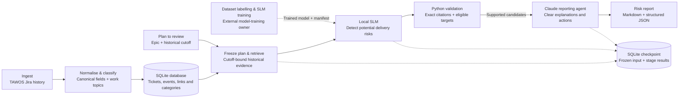

# Nabu high-level architecture

The high-level flow is **ingest → normalise and classify → database → SLM risk
identification → Claude presentation → readable report**. The CLI command is
`python -m nabu assess`; [the SLM guide](slm.md) describes setup, the model handoff
and recovery.

The integration is implemented. Dataset labelling and model training are left to
the model-training owner; no trained risk model is bundled. Live assessment
requires their trained SLM, a provenance manifest and a local compatible server.
Offline mode exercises the wiring and explicitly reports no AI analysis.

Work-topic classification at ingestion uses versioned rules. These topics help
organise work and are separate from SLM risk labels. Historical assessments
recompute topics from frozen text to avoid using later snapshot labels.

Python withholds candidates with fabricated or ineligible citations before
Claude sees them. Claude presents supported potential risks; it does not perform
the SLM's detection stage. A valid citation is not proof of a useful prediction.

The existing `review` command remains a separate LangGraph investigator/critic
baseline. Its semantic retrieval/category discovery is not the new risk SLM.
