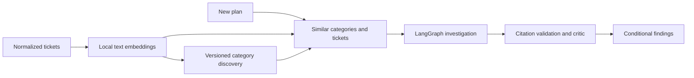

# Discovering work categories

Nabu embeds ticket titles and descriptions locally, groups similar tickets with
HDBSCAN and retrieves comparable past tickets by cosine similarity. The number
of categories is discovered from the data. No Jev classifier is required for
this path.



Categories describe **kinds of work**, such as authentication or deployment.
They do not establish failure patterns, identify missing work or predict risk.
Those claims need evidence and evaluation separately.

## Local setup

```powershell
python -m pip install -e '.[agents,semantic]'
python -m nabu prepare-model
python -m nabu discover-categories --project XD --output data/categories/xd-v1
python -m nabu search-categories --index-dir data/categories/xd-v1 --query 'database schema upgrade compatibility' --limit 5
```

The embedding model is `BAAI/bge-small-en-v1.5`, using the public quantized ONNX
assets in `Qdrant/bge-small-en-v1.5-onnx-Q`, pinned to revision
`aa8f8b060edb00e03bfdd08813a2949946c8ba55`. Preparation verifies repository blob
hashes. Inference verifies the saved asset hashes and runs locally with FastEmbed
and ONNX Runtime on CPU. Ticket text is not sent to an embedding API.
Model preparation on Windows requires PowerShell 7 (`pwsh`). The local runtime
was validated with Python 3.13; installing the semantic extra also requires a
Python version supported by its pinned scientific packages.

The model accepts up to 512 tokens. Titles and descriptions are also bounded to
the same 500/4,000-character evidence limits as the investigator; long descriptions
may therefore be truncated again by the tokenizer. Embeddings are cached by text
content and model/runtime fingerprint. Unchanged text is reused on refresh;
changed text or a changed model produces a new cache entry.
Embedding batches are ordered by text length to reduce padding, and completed
batches are committed to the cache. Retrying an interrupted discovery run reuses
those vectors; the inventory itself is published only after discovery completes.

The output directory contains `summary.md` for inspection, `categories.json`,
`tickets.json`, `vectors.npz` and a version manifest. Keyword names are proposed
automatically using weighted cluster terms from known titles, falling back to
known description text when the title is unavailable. Numeric log values are
excluded from label terms. Clustering and ticket retrieval still use title and
description embeddings. Each category includes representative
tickets and is marked `unreviewed`.

## Adding categories

Run discovery again into a new output directory when more tickets arrive:

```powershell
python -m nabu discover-categories --project XD --output data/categories/xd-v2
```

This is **batch rediscovery**. HDBSCAN can discover additional groups without a
predefined number of categories, and it can merge or split existing groups.
Membership-based IDs are local to an inventory version, not a permanent business
taxonomy. Human review and cross-version category reconciliation are future work.

Sparse or unusual tickets remain unassigned. They are still included in semantic
ticket search. A new ticket receives candidate category matches by similarity;
the returned scores are not probabilities or confirmed labels. There is currently
no calibrated novelty threshold that declares a new category from one ticket.

Discovery reduces normalized embeddings to at most 32 principal components,
normalizes again and runs HDBSCAN with Euclidean distance and leaf selection.
Defaults are a minimum cluster size of 15 and `min_samples=5`. These are initial
parameters to inspect and evaluate, not learned optimal settings. Search uses
exact cosine ranking across all eligible vectors; a vector database or ANN index
can replace that scan when corpus size requires it.

## Historical investigations

A current snapshot inventory may contain later edits. It must never be reused
as evidence for a historical backtest. To explore only text recoverable at a
cutoff, use `discover-categories --as-of ...`.

For an agent review, the graph builds its own index and categories from its frozen
historical corpus, excluding the target plan and later-created tickets:

```powershell
python -m nabu review --epic XD-238 --as-of '2013-06-17T23:59:59.999999Z' --run-dir data/reviews/xd-238-semantic --offline --retrieval semantic --pause-after-prepare
python -m nabu review --run-dir data/reviews/xd-238-semantic --resume
```

The checkpoint retains the vectors, category inventory, corpus and model
fingerprint. Resume does not recluster or re-embed documents after source changes.
Query embedding requires the same model/runtime fingerprint. Retrieval searches
all eligible tickets, including unassigned ones; category membership never limits
which evidence can be found. The historical graph uses a smaller initial minimum
cluster size of 10 and `min_samples=3` because its corpus is smaller.

`--offline` substitutes a scripted investigator. It exercises real local embedding,
retrieval and checkpointing, but performs no AI risk analysis. A live investigation
requires the model credentials described in [agents.md](agents.md).

## Validation

Controlled vector tests cover text/model cache invalidation, new categories on
batch refresh, unassigned retrieval and semantic matching without shared words.
Historical tests exclude later text and tickets. Graph tests verify that semantic
results still pass citation validation and that resume keeps frozen documents and
vectors. These tests establish behavior, not retrieval or prediction accuracy on
real tickets. That requires relevance labels and held-out historical evaluation.

The full Spring XD snapshot run indexed all 3,707 tickets and proposed 17
categories, assigning 641 tickets and leaving 3,066 (82.7%) unassigned. This sparse
inventory is a set of initial work topics, not a comprehensive classifier.
All 3,707 tickets remain searchable. `data/categories/xd-v2/summary.md` lists the
categories and representative tickets with the improved title-based labels.
The refresh reused every embedding (`new_embeddings: 0`).

Manual retrieval examples included "user authentication authorization security"
returning XD-1694 ("Provide security integration") first, and "deploy custom
modules packaging" returning XD-2089 ("Process for creating and deploying custom
XD modules") first. Saved examples include lower-ranked results too; these are
inspection examples, not an accuracy score.

The real XD-238 cutoff (`2013-06-17T23:59:59.999999Z`) produced 188 eligible prior
tickets, four proposed categories and 79 unassigned tickets. A local query about
deploying custom modules ranked XD-163, "enable grouping of modules for co-located
deployment", first. The scripted review paused and resumed with an unchanged
evidence fingerprint in `data/reviews/xd-238-semantic-verified/`. This is a plumbing
and inspection result, not a scored relevance benchmark or live risk assessment.

Model and implementation references: [FastEmbed documentation](https://qdrant.github.io/fastembed/Getting%20Started/),
[pinned model assets](https://huggingface.co/Qdrant/bge-small-en-v1.5-onnx-Q/tree/aa8f8b060edb00e03bfdd08813a2949946c8ba55),
[scikit-learn HDBSCAN](https://scikit-learn.org/stable/modules/generated/sklearn.cluster.HDBSCAN.html).
